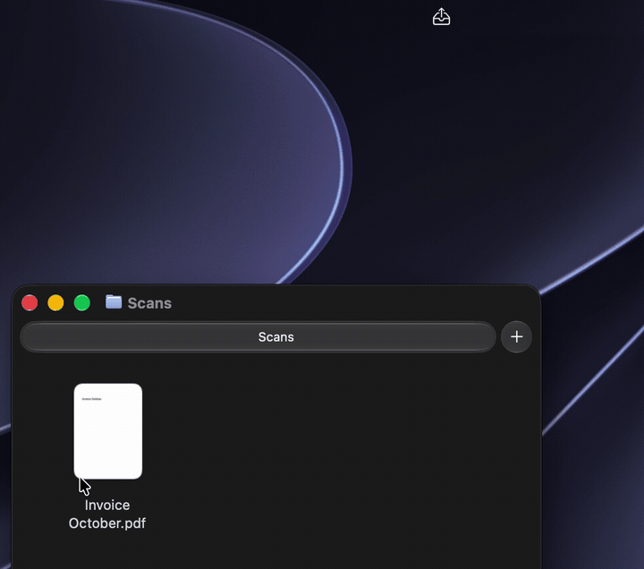
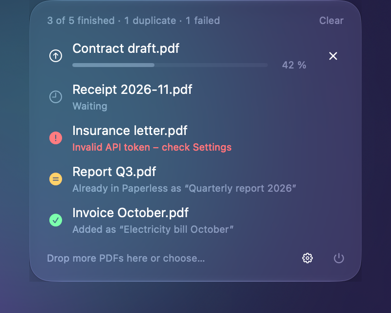
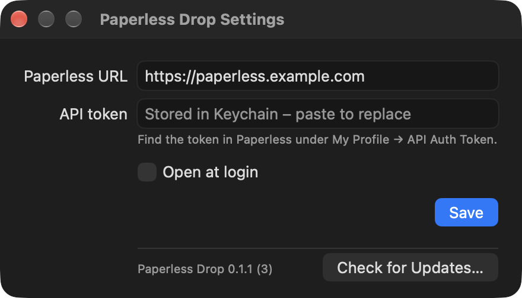

# Paperless Drop

[](https://github.com/jonasgrau/paperless-drop/actions/workflows/ci.yml)

A small macOS menu bar app that uploads PDFs to your self-hosted [paperless-ngx](https://docs.paperless-ngx.com/) instance. Drag files onto the menu bar icon and they are uploaded, processed and reported back.

> Unofficial. This project is not affiliated with or endorsed by the Paperless-ngx project.



## Features

- Drag one or more PDFs onto the menu bar icon. A panel opens under it while you drag, and you can drop onto the panel as well.
- Or click the icon and choose files (⌘O), which also works with the keyboard and VoiceOver.
- Per-file status: waiting → uploading (with progress) → processing → done, already in Paperless, or failed. Cancel a queued upload, retry a failed one, click a finished row to open the document in your browser.
- One notification per batch. A failure has a **Retry** button, and a token or URL problem opens Settings when clicked.
- Settings shows the version and can look for a newer release when you press **Check for Updates…**. It never checks by itself and installs nothing.
- Menu bar only, no Dock icon. Uses Liquid Glass on macOS 26 and newer, and a frosted material on older systems.
- Your API token lives in the Keychain. No third-party dependencies, no analytics: the app only talks to your own server, and to GitHub only when you press **Check for Updates…**.

## Screenshots

<p>
  
  
</p>

The recording and screenshots use made-up files and a local test server, not a real Paperless instance.

## Requirements

- macOS 14 or newer
- To build: Xcode 26 or newer and [XcodeGen](https://github.com/yonaskolb/XcodeGen) (`brew install xcodegen`)
- A paperless-ngx server reachable over HTTPS, and an API token. Tested with paperless-ngx 3.4.2 (API v10); the older API v9 response format is handled too.

## Install

### Download (not signed)

1. Download `PaperlessDrop-<version>.dmg` from the [Releases page](https://github.com/jonasgrau/paperless-drop/releases), open it and drag **PaperlessDrop** onto **Applications**.
2. The app is not signed with an Apple Developer ID and not notarized, so macOS blocks the first start with a message like "Apple could not verify…". That is expected. Click **Done**, open **System Settings → Privacy & Security**, scroll down to **Security**, click **Open Anyway** next to the message about Paperless Drop and confirm. The button is only there for about an hour after the blocked attempt, and you need it once ([Apple's guide](https://support.apple.com/guide/mac-help/open-a-mac-app-from-an-unidentified-developer-mh40616/mac)).
3. Optional: check the download against the checksum file of the same release. In the folder with both files, run `shasum -a 256 -c PaperlessDrop-<version>.dmg.sha256`.

The build is universal (Apple silicon and Intel). The [release workflow](.github/workflows/release.yml) makes it from the tagged source. To update, download the new dmg and replace the app in Applications (**Check for Updates…** in Settings tells you when there is one); macOS then asks for Keychain access again, because the ad-hoc signature changes with every build.

### Build and install from source

If you'd rather not bypass Gatekeeper, build it yourself. Clone the repository and run, in its folder:

```sh
./Scripts/install.sh
```

This builds a Release version, installs it into `~/Applications` and starts it. Run it again to update.

## Set up

1. In Paperless, open your profile (top right) → **My Profile** → **API Auth Token**, and copy the token (the circular arrow creates a new one).
2. Click the menu bar icon, then the gear icon (or right-click the icon → **Settings…**).
3. Enter your server address without `/api`, for example `https://paperless.example.com`, paste the token and press **Save**. The app checks the connection and shows "Connected" with the server version.
4. Optionally switch on **Open at login**.

The token is stored in the Keychain, the address in the app's preferences. Nothing is stored in the repository.

## Using it

| Action | What it does |
| --- | --- |
| Drag PDFs onto the icon | Starts the uploads; the panel closes by itself when you move away |
| Click the icon | Opens the panel until Esc, a click elsewhere or another click on the icon |
| Click the drop zone, or ⌘O | Choose PDFs in a file dialog |
| Right-click or ctrl-click the icon | Menu with Choose PDFs…, Settings… and Quit |
| ⌘, and ⌘Q | Settings and Quit, whenever the panel or Settings has the keyboard |

Quitting while uploads are running asks for confirmation first.

## Build from source

```sh
xcodegen generate
xcodebuild -project PaperlessDrop.xcodeproj -scheme PaperlessDrop -configuration Debug -derivedDataPath build build
open build/Build/Products/Debug/PaperlessDrop.app
```

Run the tests (they use a stub server, so no Paperless instance is needed):

```sh
xcodebuild test -project PaperlessDrop.xcodeproj -scheme PaperlessDrop -destination "platform=macOS" -derivedDataPath build
```

`Scripts/make-dmg.sh` builds the dmg the same way the release workflow does.

The Xcode project is generated from `project.yml` and is not committed. The app icon is drawn by `Scripts/make-icon.swift` (`swift Scripts/make-icon.swift`).

To read the logs, use the full path because `log` is a built-in in zsh:

```sh
/usr/bin/log stream --predicate 'subsystem == "de.jonas.PaperlessDrop"' --level debug
```

If you fork it, change the bundle identifier in `project.yml`, and the matching identifier in `Sources/Keychain.swift` and `Sources/DropTarget.swift`.

## How it talks to Paperless

- `POST /api/documents/post_document/` as `multipart/form-data` (file field `document`), authenticated with `Authorization: Token <token>`. The file is streamed from a temporary file, so large PDFs do not fill memory.
- The response is a task ID. The app polls `GET /api/tasks/?task_id=<id>` until the task succeeds or fails, reading both the v10 format (paginated, lowercase status) and the v9 format (plain array, uppercase status).
- After a success it asks for the document's title (`GET /api/documents/<id>/?fields=title`) so it can show a name instead of a number.

## How the update check works

**Check for Updates…** (in Settings) asks `GET https://api.github.com/repos/jonasgrau/paperless-drop/releases` and compares the newest release with the running version. It only runs when you press the button, sends nothing but the app version in the User-Agent header, and installs nothing: the link opens the release page in your browser.

## Troubleshooting

- **macOS says it can't verify the app, or blocks it.** The download is not notarized. Use **Open Anyway** as described under Install.
- **The Keychain asks for access after every rebuild.** The app is signed ad-hoc, so each build looks like a new program to macOS. Click "Always Allow", or set your own signing identity in `project.yml`.
- **Notifications show an empty icon.** macOS caches icons system-wide. Run `sudo rm -rf /Library/Caches/com.apple.iconservices.store && sudo killall iconservicesd iconservicesagent` in Terminal, then `killall NotificationCenter usernoted`.
- **My server uses plain `http://`.** macOS blocks that by default (App Transport Security). Add an exception under `info.properties` in `project.yml`, for example `NSAppTransportSecurity: { NSAllowsLocalNetworking: true }` for a server on your local network.
- **Turning on the App Sandbox** would need the entitlements `com.apple.security.app-sandbox`, `com.apple.security.network.client` and `com.apple.security.files.user-selected.read-only`.

## License

[MIT](LICENSE)
